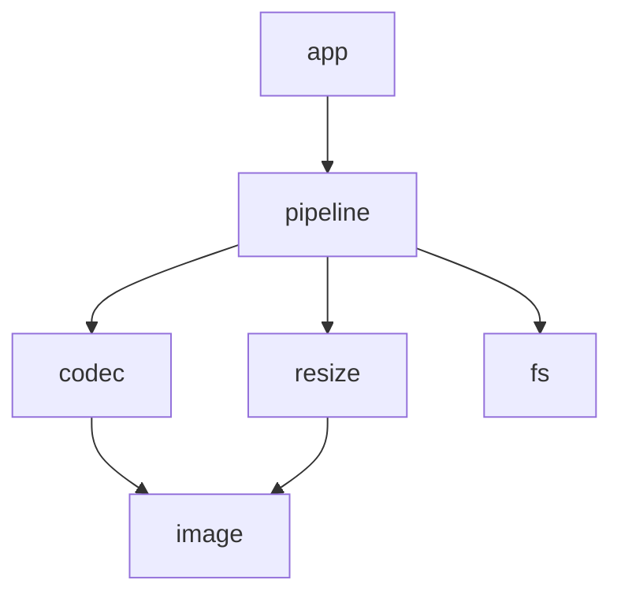
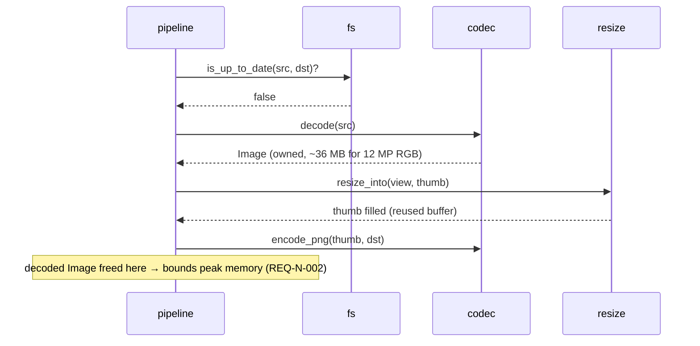

# Example 2 — Architecture

# thumbgen — Architecture v0.1
Satisfies: REQ-F-001…004, REQ-N-001…003

## 1. Context
A single command-line executable. Input: a folder of images. Output: a folder of thumbnails + exit code.

## 2. Modules
| Module | Responsibility | Knows about |
|---|---|---|
| `app` | Parse arguments, wire modules, report results, exit code | everything below |
| `pipeline` | Decide which files to process, schedule work, collect errors | `codec`, `resize`, `fs` |
| `codec` | Decode PNG/JPEG into pixels, encode pixels to PNG | `image` |
| `resize` | Scale an image to a target size | `image` |
| `fs` | List files, timestamps, paths (wraps `std::filesystem`) | – |
| `image` | Plain pixel container types | – |

> 💡 **Why:** each module has *one* responsibility you can say in a sentence. The "Knows about" column
> makes dependencies explicit before any code exists.

## 3. Dependency rules

Rules:
1. Arrows point downward only. No cycles.
2. `image` and `fs` depend on nothing in the project.
3. Third-party libraries (stb_image) are used **only inside `codec`** — no other module includes them.

> 💡 **Why:** rule 3 is the key one: if the decoder library changes, only one module changes.
> In your own project the same rule hides frameworks, OS and graphics/database APIs behind your own modules.

## 4. Data flow — processing one file

> 💡 **Why:** the sequence diagram shows *who owns which data and when it is freed* — that is what
> lets you reason about the memory budget before writing code.

## 5. Threading model
N worker threads (N = hardware threads), each processes whole files. See ADR-0002.
Peak memory ≈ N × largest decoded image → with N = 8 and 36 MB → ~290 MB (REQ-N-002: ≤ 300 MB).

## 6. Error handling
`codec` and `fs` return `std::optional` / error structs; no exceptions cross module boundaries.
`pipeline` collects per-file errors; `app` maps them to exit codes (REQ-F-003).

## 7. Extension points
New formats = new decoder inside `codec`; nothing else changes.
